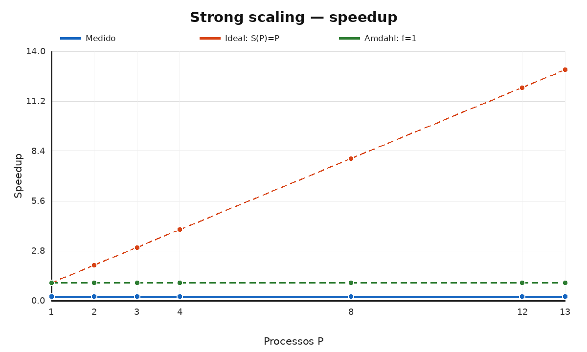
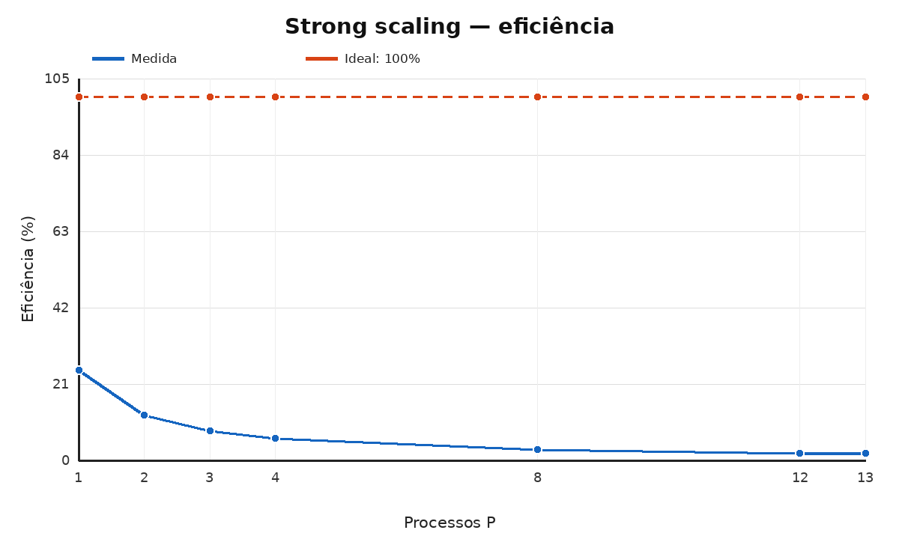
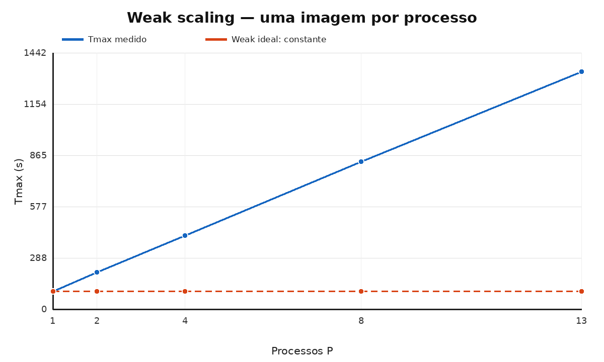
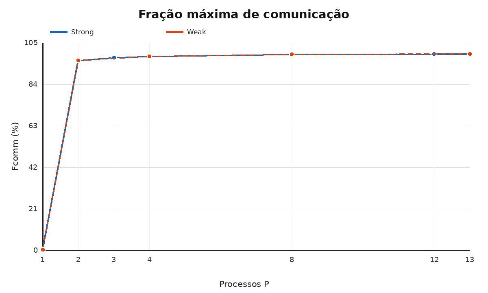
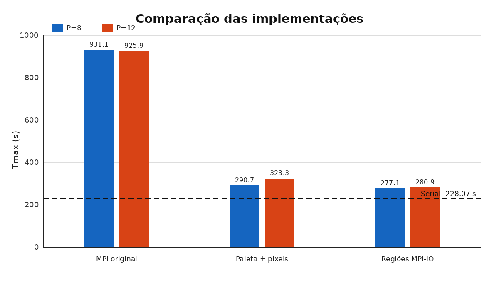

# Color_quantization_MPI

# Relatório consolidado de tempos, strong scaling, weak scaling e Lei de Amdahl

Este documento consolida os arquivos serial_raw.tsv, strong_raw.tsv, weak_raw.tsv e os logs das versões não bloqueante, otimizada e MPI-IO por regiões.

## 1. Metodologia e fórmulas

Baseline serial para o lote fixo de nove imagens:

Tserial = 228,069766045 s.

Para strong scaling:

Speedup(P) = Tserial / Tmax(P)

Eficiência(P) = Speedup(P) / P

Nessas expressões:

- **P** é o número de processos MPI usados na execução;
- **Tserial** é o tempo da implementação serial para resolver o mesmo problema, com o mesmo lote fixo de nove imagens;
- **Tmax(P)** é o tempo total do rank mais lento quando são usados P processos. O máximo é necessário porque a execução paralela só termina quando o rank mais lento termina;
- **Speedup(P)** indica quantas vezes a versão paralela é mais rápida que a serial;
- **Eficiência(P)** mede quanto da capacidade teórica dos P processos foi efetivamente aproveitada.

Interpretação do speedup:

- Speedup = 1: a versão paralela tem o mesmo tempo da serial;
- Speedup > 1: houve aceleração;
- Speedup = P: aceleração ideal, isto é, dobrar os processos divide o tempo por dois;
- Speedup < 1: a versão paralela ficou mais lenta que a serial devido aos custos de comunicação, sincronização, I/O ou partes seriais.

A eficiência normalmente é apresentada como porcentagem:

Eficiência percentual(P) = 100 × Speedup(P) / P

Uma eficiência de 100% representa o caso ideal. Por exemplo, speedup 8 com P=8 corresponde a 100% de eficiência. Speedup 4 com P=8 corresponde a 50%, pois os oito processos entregaram desempenho equivalente ao ganho ideal de apenas quatro.

No MPI original deste trabalho, para P=8:

- Tserial = 228,069766 s;
- Tmax(8) = 931,131945 s;
- Speedup(8) = 228,069766 / 931,131945 = 0,244938;
- Eficiência(8) = 0,244938 / 8 = 0,030617, ou 3,06%.

Portanto, essa execução MPI demorou aproximadamente 4,08 vezes o tempo da serial e aproveitou apenas 3,06% do ganho ideal para oito processos. Isso ocorre porque o tempo de comunicação e espera coletiva domina a execução.

Fração de comunicação:

Fcomm(P) = Tcomunicação,max(P) / Ttotal,max(P)

Para a Lei de Amdahl:

Speedup_Amdahl(P) = 1 / (f + (1-f)/P)

Fração serial inferida:

f(P) = (1/Speedup(P) - 1/P) / (1 - 1/P)

Tmax é usado porque o rank mais lento determina quando a seção paralela termina. Tcomp,médio e Tcomm,médio são médias entre ranks; Fcomm usa os máximos, conforme solicitado.

Foram realizadas duas repetições no strong scaling e uma no weak scaling, por decisão tomada durante a execução. Isso é inferior às três repetições previstas originalmente.

## 2. Análise do tempo serial

| Repetição | Tempo interno (s) | Wall externo (s) | User launcher (s) | System launcher (s) | Max RSS launcher (KB) |
|---:|---:|---:|---:|---:|---:|
| 1 | 228,636934 | 229,276047 | 0,024585 | 0,026779 | 8.576 |
| 2 | 227,502598 | 229,081319 | 0,022692 | 0,030585 | 8.576 |
| **Média** | **228,069766** | **229,178683** | **0,023639** | **0,028682** | **8.576** |
| **Desvio amostral** | **0,802096** | **0,137693** | — | — | — |

O volume de nove imagens garantiu mais de 200 segundos. O tempo interno mede o processamento do lote; o wall externo inclui inicialização, leitura, escrita e encerramento.

## 3. Strong scaling — uma até treze unidades de processamento

O tamanho permaneceu fixo em nove imagens.

### Desempenho no strong scaling

| P | Tmax médio (s) | Desvio (s) | Speedup | Eficiência |
|---:|---:|---:|---:|---:|
| 1 | 920,700 | 16,758 | 0,247714 | 24,77% |
| 2 | 920,516 | 9,772 | 0,247763 | 12,39% |
| 3 | 932,818 | 8,959 | 0,244496 | 8,15% |
| 4 | 924,519 | 2,161 | 0,246690 | 6,17% |
| 8 | 931,132 | 8,139 | 0,244938 | 3,06% |
| 12 | 925,919 | 0,877 | 0,246317 | 2,05% |
| 13 | 936,278 | 9,478 | 0,243592 | 1,87% |

### Tempos internos e comunicação no strong scaling

| P | Tcomp médio (s) | Tcomm médio (s) | Tcomp máximo (s) | Tcomm máximo (s) | Fcomm |
|---:|---:|---:|---:|---:|---:|
| 1 | 827,537 | 4,069 | 827,537 | 4,069 | 0,44% |
| 2 | 412,830 | 462,178 | 789,220 | 884,060 | 96,04% |
| 3 | 278,263 | 623,129 | 785,903 | 908,859 | 97,43% |
| 4 | 207,294 | 694,361 | 774,018 | 906,619 | 98,06% |
| 8 | 104,471 | 815,237 | 770,423 | 922,132 | 99,03% |
| 12 | 69,258 | 849,137 | 762,113 | 919,863 | 99,35% |
| 13 | 64,540 | 864,597 | 769,288 | 930,653 | 99,40% |

### Discussão do strong scaling

- A versão MPI com P=1 já é aproximadamente quatro vezes mais lenta que a serial: 920,700 s contra 228,070 s.
- Aumentar P não reduz Tmax. Todos os pontos permanecem entre aproximadamente 920 e 936 s.
- Tcomp,médio cai porque os workers recebem menos pixels, mas Tcomp,max permanece entre 762 e 789 s devido ao trabalho concentrado no rank 0.
- Tcomm,médio cresce de 4,069 s em P=1 para 864,597 s em P=13.
- Fcomm sobe de 0,44% para 99,40%.
- A eficiência cai de 24,77% em P=1 para 1,87% em P=13.
- A curva se afasta da ideal imediatamente; não existe região de ganho no MPI original.

A saturação é causada por comunicação intensiva e espera coletiva. Quando P cresce, os workers terminam seus blocos mais cedo e aguardam o rank 0 reconstruir e reduzir a octree global. Essa espera ocorre dentro das coletivas e aparece em Tcomm.

## 4. Lei de Amdahl — strong scaling original

| P | Speedup medido | Speedup ideal | Fração serial bruta f(P) | Amdahl com f limitado a 1 |
|---:|---:|---:|---:|---:|
| 1 | 0,247714 | 1 | não definida | 1 |
| 2 | 0,247763 | 2 | 7,072230 | 1 |
| 3 | 0,244496 | 3 | 5,635080 | 1 |
| 4 | 0,246690 | 4 | 5,071558 | 1 |
| 8 | 0,244938 | 8 | 4,523043 | 1 |
| 12 | 0,246317 | 12 | 4,337972 | 1 |
| 13 | 0,243592 | 13 | 4,363994 | 1 |

A fração serial deveria estar entre zero e um. Os valores de 4,34 a 7,07 são não físicos porque a versão paralela é mais lenta que a serial. A Lei de Amdahl modela apenas a divisão entre parte serial e paralela; ela não representa diretamente o grande overhead adicional de reconstrução, movimentação de dados, sincronização e espera.

Se f for limitado ao intervalo físico, obtém-se f=1 e Speedup_Amdahl=1 para qualquer P. Mesmo essa previsão pessimista ainda é superior aos speedups medidos, confirmando que o problema não é apenas uma grande fração serial: há overhead paralelo substancial.

## 5. Weak scaling

No weak scaling foi mantida uma imagem de trabalho por processo: Ntotal=P. O indicador adequado é eficiência weak = T(P=1)/T(P), pois o tamanho total varia e o speedup tradicional contra a serial de nove imagens não é comparável.

### Desempenho no weak scaling

| P | Imagens (Ntotal) | Tmax (s) | Eficiência weak |
|---:|---:|---:|---:|
| 1 | 1 | 99,070 | 100,00% |
| 2 | 2 | 208,360 | 47,55% |
| 4 | 4 | 414,061 | 23,93% |
| 8 | 8 | 830,177 | 11,93% |
| 13 | 13 | 1.335,337 | 7,42% |

### Tempos internos e comunicação no weak scaling

| P | Tcomp médio (s) | Tcomm médio (s) | Tcomm máximo (s) | Fcomm |
|---:|---:|---:|---:|---:|
| 1 | 92,481 | 0,398 | 0,398 | 0,40% |
| 2 | 93,910 | 104,482 | 199,911 | 95,95% |
| 4 | 92,400 | 310,916 | 406,088 | 98,07% |
| 8 | 92,961 | 726,855 | 822,126 | 99,03% |
| 13 | 91,717 | 1.233,122 | 1.327,253 | 99,39% |

### Discussão do weak scaling

Tcomp,médio permanece próximo de 92–94 s, mostrando que o trabalho médio de pixels por rank ficou aproximadamente constante. Entretanto, Tmax cresce quase linearmente e Tcomm domina a execução.

T(13)/T(1) = 13,479.

Em um weak scaling ideal, essa razão seria próxima de 1. O volume de comunicação e a espera crescem com P porque cada imagem continua exigindo construção centralizada de paleta e coletivas. A implementação não apresenta boa escalabilidade fraca segundo Gustafson.

## 6. Medição externa do strong scaling

| P | Wall médio (s) | User launcher (s) | System launcher (s) | Max RSS launcher (KB) |
|---:|---:|---:|---:|---:|
| 1 | 933,590 | 0,365 | 0,115 | 9.792 |
| 2 | 929,257 | 0,353 | 0,123 | 9.830 |
| 3 | 936,902 | 0,193 | 0,079 | 9.152 |
| 4 | 928,225 | 0,027 | 0,033 | 8.640 |
| 8 | 934,129 | 0,023 | 0,039 | 8.576 |
| 13 | 939,914 | 0,030 | 0,034 | 8.768 |

O wrapper externo mede mpirun, não os ranks individualmente. Por isso, MPI_Wtime e Tmax são as referências de execução paralela. RSS, user e system externos não representam a soma dos processos remotos.

## 7. Comparação com as implementações otimizadas

### 7.1 Implementação MPI original

Na **color_quant_MPI.c**, o rank 0 lê a imagem e distribui seus pixels com `MPI_Scatterv`. Cada rank constrói uma octree local e envia suas folhas ao rank 0 por `MPI_Gather`/`MPI_Gatherv`. O rank 0 reconstrói e reduz a octree global, transmite a paleta com `MPI_Bcast`, e os ranks alteram seus blocos. Por fim, `MPI_Gatherv` devolve os pixels ao rank 0 para escrita.

A redução global permanece concentrada no rank 0, e aproximadamente 496 MB são enviados e 496 MB retornam por imagem. Por isso, o aumento de P reduz o trabalho médio dos workers, mas não reduz o caminho crítico.

### 7.2 Tentativa com coletivas não bloqueantes

Na **color_quant_MPI_nao_bloqueante.c**, `Bcast`, `Scatterv`, `Gather`, `Gatherv` e as barreiras foram substituídos por `MPI_Ibcast`, `MPI_Iscatterv`, `MPI_Igather`, `MPI_Igatherv` e `MPI_Ibarrier`.

Cada chamada foi seguida imediatamente por `MPI_Wait`; portanto, não havia trabalho independente para executar enquanto a comunicação progredia. O volume transferido e a centralização no rank 0 permaneceram iguais. Em P=13, a versão não bloqueante obteve 947,957 s, ficando 1,25% mais lenta que a média da original. A conclusão é que comunicação não bloqueante só traz benefício quando o algoritmo permite sobreposição real.

### 7.3 Otimização 1 — paleta serial e pixels paralelos

Na **color_quant_MPI_otimizado.c**, a redução distribuída da octree foi removida:

- o rank 0 constrói a paleta com a mesma inserção, heap e ordem da versão serial;
- deixam de existir as octrees locais, o envio de folhas e a reconstrução global;
- a árvore reduzida é convertida em uma LUT RGB de 6.291.456 bytes e transmitida por `MPI_Bcast`;
- cada rank usa a LUT para alterar somente seus pixels;
- `MPI_Scatterv`, `MPI_Gatherv`, leitura e escrita centralizadas são mantidos.

Essa mudança preservou a saída serial byte a byte e reduziu `Tmax` para 290,741 s em P=8 e 323,275 s em P=12. Entretanto, cerca de 1 GB de pixels por imagem ainda atravessava o rank 0, e o broadcast da LUT acrescentava 6 MB por imagem.

### 7.4 Otimização 2 — regiões com MPI-IO

Na **color_quant_MPI_regioes.c**, a movimentação centralizada dos pixels foi eliminada:

- cada worker lê diretamente seu bloco contíguo com `MPI_File_read_at`;
- o rank 0 constrói a paleta serial enquanto os workers realizam suas leituras;
- a árvore reduzida é achatada e transmitida em formato compacto — quatro nós, aproximadamente 144 bytes no experimento — substituindo a LUT de 6 MB;
- cada rank altera sua própria região;
- o rank 0 escreve o cabeçalho e os ranks gravam os pixels diretamente com `MPI_File_write_at_all`;
- deixam de existir `MPI_Scatterv` e `MPI_Gatherv` dos pixels.

A versão removeu aproximadamente 1 GB de comunicação centralizada por imagem, manteve a saída exatamente igual à serial e reduziu `Fcomm` para cerca de 14%. `Tmax` caiu para 277,115 s em P=8 e 280,902 s em P=12. O custo dominante migrou para MPI-IO (`Tio` de 85–86% de `Tmax`), e o rank 0 ainda precisa ler a imagem completa e construir a paleta serialmente.

### 7.5 Resumo das otimizações

| Versão | O que foi removido ou modificado | O que permaneceu | Resultado principal |
|---|---|---|---|
| Não bloqueante | coletivas trocadas por variantes `MPI_I*` | espera imediata, mesmo tráfego e mesma redução centralizada | 1,25% mais lenta em P=13 |
| Paleta + pixels | octrees locais, reunião de folhas e reconstrução global | `Scatterv/Gatherv` dos pixels e paleta serial no rank 0 | 3,203× sobre a original em P=8 |
| Regiões MPI-IO | `Scatterv/Gatherv` dos pixels e broadcast da LUT | paleta serial e leitura completa no rank 0 | 3,360× sobre a original em P=8; `Fcomm` ≈14% |

Os hashes SHA-256 das duas versões otimizadas foram comparados com os da serial e confirmaram igualdade byte a byte das nove imagens.

| Implementação | P | Tmax (s) | Fcomm | Speedup vs. serial | Eficiência | Fator de melhoria vs. MPI original |
|---|---:|---:|---:|---:|---:|---:|
| MPI original | 8 | 931,131945 | 99,03% | 0,244938 | 3,06% | 1,000× |
| Paleta serial + pixels | 8 | 290,740940 | 99,11% | 0,784443 | 9,81% | 3,203× |
| MPI-IO por regiões | 8 | **277,114977** | **13,99%** | **0,823015** | **10,29%** | **3,360×** |
| MPI original | 12 | 925,919325 | 99,35% | 0,246317 | 2,05% | 1,000× |
| Paleta serial + pixels | 12 | 323,274719 | 99,47% | 0,705498 | 5,88% | 2,864× |
| MPI-IO por regiões | 12 | **280,902320** | **13,80%** | **0,811918** | **6,77%** | **3,296×** |

A versão por regiões removeu Scatterv/Gatherv dos pixels, reduziu Fcomm para cerca de 14% e foi a melhor MPI. Ela ainda não superou a baseline serial: o melhor speedup foi 0,823 em P=8. O custo dominante migrou para MPI-IO e para a construção serial da paleta no rank 0.

## 8. Conclusões

1. O MPI original não escala: speedup permanece próximo de 0,245 para todos os P.
2. Fcomm cresce rapidamente e alcança aproximadamente 99% a partir de P=8.
3. Tcomp,médio cai com P, mas Tcomp,max permanece alto, comprovando desbalanceamento.
4. O weak scaling é ruim: Tmax cresce aproximadamente na mesma proporção que P.
5. A Lei de Amdahl pura não ajusta os dados, pois o overhead produz speedup menor que 1 e frações seriais inferidas acima de 1.
6. A otimização por regiões melhorou a MPI original em até 3,360 vezes, mas ainda ficou abaixo da serial.
7. P=8 foi melhor que P=12; aumentar processos além desse ponto acrescentou overhead sem ganho.
8. O próximo passo é reduzir a construção serial da paleta e as leituras redundantes do rank 0.

## 9. Arquivos consolidados

Todos os dados e logs importantes estão organizados em [`resultados`](resultados/README.md).

Dados principais:

- [`serial_raw.tsv`](resultados/dados/serial_raw.tsv)
- [`strong_raw.tsv`](resultados/dados/strong_raw.tsv)
- [`weak_raw.tsv`](resultados/dados/weak_raw.tsv)
- [`tabela_strong_calculada.tsv`](resultados/dados/tabela_strong_calculada.tsv)
- [`tabela_weak_calculada.tsv`](resultados/dados/tabela_weak_calculada.tsv)

Evidências individuais:

- [logs do serial](resultados/logs/serial)
- [logs do strong scaling](resultados/logs/strong)
- [logs do weak scaling](resultados/logs/weak)
- [logs das versões otimizadas](resultados/logs/otimizacoes)
- [hashes de validação contra a serial](resultados/logs/hashes)
- [logs gerais de execução](resultados/logs/execucao)

Os gráficos usados neste relatório estão em [`graficos`](graficos).

